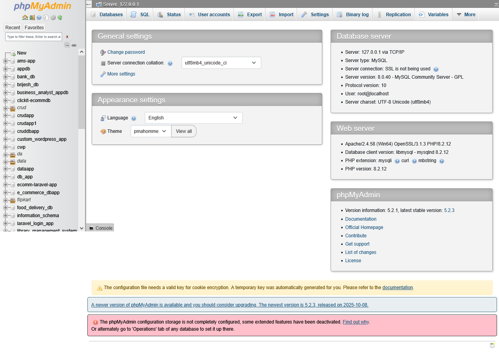
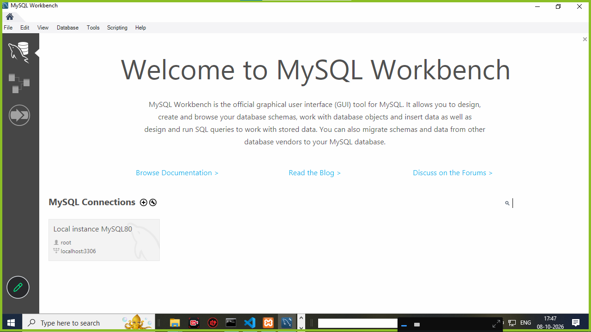
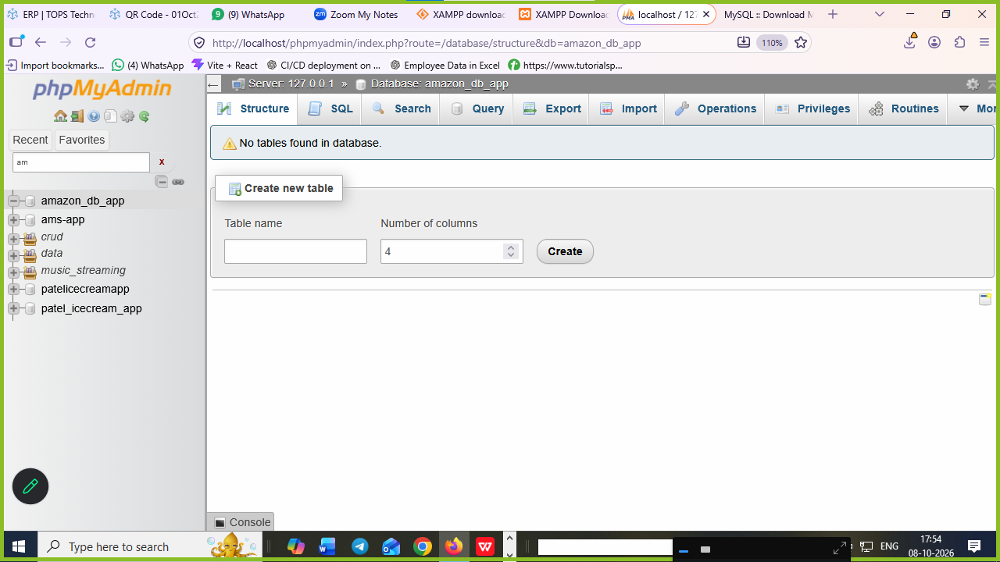

# what is SQL ?

1. SQL is stands for structured query language 
2. SQL is used to create an structured of **database** and **table**
3. SQL is case insestive language
**examples : insert | Insert | INSERT**
4. SQL is used to created structured 
5. SQL create database
6. SQL also create tables    
7. SQL should not create logic  its create a query 
# DBMS or MySQL setup 

1. download xampp server tools and install
```
https://www.apachefriends.org/
xampp => xampp control => start apache and mysql service
open any broswers 
localhost/phpmyadmin
```


2. download Mysqlworkbench8.0 and install

```
download and install 
start menu mysqlwordkbench

```




# SQL query or command 

# Types of SQL commands ? 

1. DDL (data definition language)
2. DML (data manipulation language)
3. DQL (data query language)
4. TCL (transactional control language) 


# DDL (data definition language)

- DDL used to create database structured 
- DDL is used to create table structured 
- DDL is used to add | modify | rename | change column name from tables 
- DDL also used to rename table name 
- DDL is also used to delete table and database structured 

**query of DDL is :**

1. create 
2. alter 
3. rename 
4. change
5. truncate 
6. drop

# how to create database structured ? 

- create database name 

**syntax**

```
create database databasename;
```

**query**

```
create database amazon_db_app;

```

**screenshot of examples**




# create a table  first know about column name datatype and size

|     columnname           |   datatype(size)       |   key constraints   |
|--------------------------|------------------------|---------------------|
| id                       | int                    | pk auto_increment   |
| name                     | char(0-255)            | not null            | 
| email, password          | varchar(0-255)         | not null            |
| address, comment         | text                   | not null            | 
| multiple choice          | enum                  | not null             | 
| date                     | date                  | not null             |
| datetime                 | datetime              | not null             |
| photo small              | blob                  | not null             | 
| photo big size           | varchar(0-255)        | not null             | 
| salary                   | decimal(10,2)         | not null             | 
| price                    | float, money          | not null             |
| default_date_time        | timestamp             | not null             |


# how to create tables structured in database ? 

- table create in form of **row and column**
**syntax**

```
create table tablename(
columnname datatype(size) primary key auto_increment,
.
.
.
.
column name datatype(size)
)

or

create table users(

id int primary key AUTO_INCREMENT,
name varchar(255),
email varchar(255),
password varchar(255),
mobile bigint,
address text,
country varchar(255)

)

or

create table employee(

empid int primary key AUTO_INCREMENT,
name varchar(255),
email varchar(255),
password varchar(255),
mobile bigint,
address text,
salary decimal(10,2),
department varchar(255),
country varchar(255)

)

or

create table contact(
contactid int primary key AUTO_INCREMENT,
name varchar(255),
email varchar(255),
mobile bigint,
message text,
created_date date
)

or

create table feedback(
fid int primary key AUTO_INCREMENT,
name varchar(255),
email varchar(255),
mobile bigint,
rating enum('*','**','***','****','*****'),
comment text,
created_date date
)

```

# alter 
1. alter is used to add new column after create tables 
2. alter update any column name 
3. alter is use to delete any column name 

**examples**

```
alter table users add state varchar(255);
or
alter table users change address permanent_address text;
or
alter table users drop state;
or
alter table users add pincode int after mobile;
```


# rename :

1. rename is used to rename the table name after create table 

```
rename table contact to tbl_contact
or
rename table users to tbl_users
or
rename table employee to tbl_employee
```

# drop 
1. drop is used to delete database 
2. drop is used to delete table

```
drop database databasename;
or
drop database amazon_db_app;
or
drop table tablename;
or
drop table tbl_users;
```

# truncate :

1. truncate is used to delete data from tables 
2. truncate is used to delete all data from tables after truncate data we can not rollback data.

```
truncate table tbl_contact
```
# DML : 
1. data manipulation language 
2. dml is used to insert | delete | update table in tables 

# DML query are ..

1. insert 
2. delete 
3. update 

# insert :
- insert a single data in tables 
- insert a  multiple data in tables 

```
insert into tbl_employee(name,email,password,mobile,address,salary,department,country) VALUES('om','om@gmail.com','om123',9998003879,'150 feet ring road rajkot',145000,'IT','india');

or

insert into tbl_employee(name,email,password,mobile,address,salary,department,country) VALUES('twinkle','twinkle@gmail.com','tw123',9998003899,'150 feet ring road rajkot',145000,'IT','india'),('mahiraj','mahiraj@gmail.com','mahi123',9998003889,'150 feet ring road ahemdabad',155000,'CSE','india');

or

insert into tbl_employee VALUES(null,'brijesh','brijesh@gmail.com','brij123',9998008899,'150 feet ring road rajkot',145000,'EC','india'),(null,'rakesh','rakesh@gmail.com','rakesh123',9998003889,'150 feet ring road ahemdabad',155000,'CSE','india');

```

# delete data ? 
1. delete is used to delete all data 
2. delete is also used to delete a single 
3. delete is also used to delete a alternate data 
4. delete is also used to delete a range of data 
5. after delete we can rollback data

**examples**

```
delete from tbl_employee;
or
delete from tbl_employee where empid=1;
or
delete from tbl_employee where name='brijesh';
or
delete from tbl_employee where empid in(2,4);
or
delete from tbl_employee where empid between 50 and 100;

```

# update data from table ?
1. update data from tables 

**examples**
```
update tbl_employee set name='rakesh',email='rakesh@gmail.com',mobile=81362200,address='CA b/USA',salary=850000,department='DA', country='USA' where empid=5;

```


# DQL :
1. data query language 
2. data query language is used to select data or fetch data 
3. DQL is used basically for select data

# DQL query are ...

1. select 

```
select * from tbl_employee;
or
select * from tbl_employee where empid=2;
or
select * from tbl_employee where name='mahiraj';
or
select * from tbl_employee where empid in(2,4);
or
select * from tbl_employee where empid between 50 and 70;
or
select empid,name,email,mobile from tbl_employee;
or
select empid,name,email,mobile from tbl_employee where empid in (2,3);
or
select empid,name,email,mobile from tbl_employee where empid in (2,3);
or
select empid,name,email,mobile from tbl_employee where empid between 2 and 5;

```

# limit  ...

- limit is used for select data apply limit keyword

**syntax or examples**

```
select * from tbl_employee where empid limit 0,5;
or
select * from tbl_employee where empid limit 2,4;
or

select * from tbl_employee where empid limit 1,3;
```

# order  by :

- order by is used to select data in **ascending** or **descending** order
- order by by default sort data **asc**

**syntax or examples**
```
select * from tbl_employee order by name asc;
or
select * from tbl_employee order by empid asc;
or
select * from tbl_employee order by name desc;
or
select * from tbl_employee order by empid desc;
or
select * from tbl_employee order by name;

```
# group by :

- group by is used to filter data on group of columns 
- group by always used to applied on group of columns 
- group by used having keyword for checking condition 
- after group by **having** is used in place of where

**syntax and examples**

```
select sum(salary), department from tbl_employee group by department;
or
select sum(salary), department from tbl_employee where salary >50000 group by department;

or

select sum(salary), department from tbl_employee where age >25 group by department having sum(salary) >65000;

or

select sum(salary), department from tbl_employee where age >25 group by department having sum(salary) >155000;

or

select sum(salary), department from tbl_employee where age >25 group by department having sum(salary) >655000;

```

# like operator : 

- like operator is used for searching data from table with keyword
- like operator is used for searching 

**examples and syntax**

```
select * from tbl_employee where name like 't%'
or
select * from tbl_employee where name like 'o%'
or
select * from tbl_employee where name like '%h'
or
select * from tbl_employee where name like '%a%'

```
# what is subquery ?
1. subquery are used to query within another query i.e called subquery 
2. query within another query i.e called subquery 

```
**example**
select max(salary) as second_highest_salary from tbl_employee where salary <(select max(salary) from tbl_employee)

or 

select max(salary) from tbl_employee where salary < (select max(salary) FROM tbl_employee)

```

# w.a.q to find second highest salary ...
1. w.a.q to find second highest salary via sub query 
2. subquery are used to query within another query 

# examples 

```
select max(salary) as second_highest_salary from tbl_employee where salary <(select max(salary) from tbl_employee)

```

# w.a.q to find a second_highest_salary from tables employee but used limit and order by 

# examples ..

```
select salary as second_highest_salary from tbl_employee order by salary desc limit 1,1;
or
select salary as third_highest_salary from tbl_employee order by salary desc limit 2,1;
or
select salary as fourth_highest_salary from tbl_employee order by salary desc limit 3,1;

```

# w.a.q of find systems default time and date with timezone
# examples

```
select now();
or
select CURRENT_DATE();
or
select CURRENT_TIME();
```

# w.a.q to get sum of salary to those employee whose age is greater than 30 years and department is it 

```
select sum(salary) from tbl_employee where age>30 and department='IT';
or
select sum(salary) from tbl_employee where age>30 and department='CSE';
or
select sum(salary) from tbl_employee where age>=30 and department='EC';

```
# w.a.q to find sum of salary on department wise using group by
```
select sum(salary), department from tbl_employee group by department
```

# w.a.p to find max salary , second highest salary , third highest salary 

```
select * from tbl_employee order by salary  desc limit 0,1; 
or
select * from tbl_employee order by salary  desc limit 1,1;
or
select * from tbl_employee order by salary  desc limit 2,1;
or
select * from tbl_employee order by salary  desc limit 3,1;   

```


# SQL function ...

1. SQL function provides some inbuilt function to performed any task
2. SQL function is used to provides max | min | avg | count | sum etc 

# types of SQL function 

1. aggrigate function 
2. scalar function 

# aggrigate function 

- max()
- min()
- avg()
- sum()
- count()

# examples 

```
select max(salary) from tbl_employee;
or
select min(salary) from tbl_employee;
or
select avg(salary) from tbl_employee;
or
select sum(salary) from tbl_employee;
or
select count(empid) from tbl_employee;
or
select sum(salary) as sumof_salary from tbl_employee;
```

# scalar function 

- first()
- last()
- lcase()
- ucase()
- now()

# examples 

```
select first(empid) from tbl_employee
or
select last(empid) from tbl_employee
or
select lcase(name) from tbl_employee
or
select ucase(name) from tbl_employee
or
select now()
or
select CURRENT_DATE();
or
select CURRENT_DATE();
or
select CURRENT_TIME()
or
select CURRENT_TIMESTAMP()

```

# TCL : transactional query language 

1. TCL stands for transactional query language 
2. TCL is used for commit and rollback data 

# query are .. 

1. commit 
2. rollback 

1. commit : commit is used to save data after deleted data 
2. rollback: rollback are used to rollback a data after deleted 

# examples : 

```
start TRANSACTION;
delete from tbl_employee where empid=8;
select * from tbl_employee where empid=8;
rollback;
select * from tbl_employee where empid=8;


```

# SQL key constraints ? 
1. SQL key constraints provides limit on tables 
2. there are some types of key constraints 

# types of SQL key constraints 

1. primary key 
2. unique key 
3. foreign key 
4. compound key 